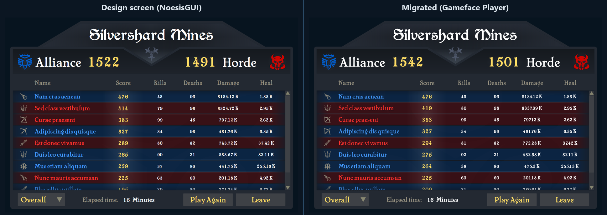

import Summary from 'coherent-docs-theme/components/Summary.astro';
import Highlight from 'coherent-docs-theme/components/Highlight.astro';
import { Steps } from '@astrojs/starlight/components';
import inventoryResolutionsVideo from "../../../assets/building-with-ai/xaml-migration/inventory-resolutions.webm";
import detroitMenusVideo from "../../../assets/building-with-ai/xaml-migration/detroit-menus.webm";
import radialMenuGamepadVideo from "../../../assets/building-with-ai/xaml-migration/radial-menu-gamepad.webm";
import inventoryDragDropVideo from "../../../assets/building-with-ai/xaml-migration/inventory-drag-drop.webm";

<Summary>
    A coding agent can migrate a NoesisGUI interface to Gameface without starting over. This article shares the workflow and tools we used to preserve existing UI work and verify the result.
</Summary>

## What We Tested

We migrated a range of NoesisGUI's open-source samples to Gameface, from simple buttons and a login form to a 3D drag-and-drop [inventory](https://github.com/Noesis/Tutorials/tree/master/Samples/Inventory) and animation-heavy menus like the ones [recreated from Detroit: Become Human](https://github.com/Noesis/Tutorials/tree/master/Samples/Detroit).

The last test replicated a real handover: the agent rebuilt the [Scoreboard sample](https://github.com/Noesis/Tutorials/tree/master/Samples/Scoreboard) from its XAML and design screens alone, with no running build to copy from, and matched every screen within ±2px.



*The Scoreboard design screen (left) and the migrated screen running in the Gameface Player (right).*
These were internal research projects, not released samples. The reusable outcome is the workflow described below.

## Migrate and Improve

Gameface is built on web technology, so plan for <Highlight>migration plus improvement</Highlight>, not a strict 1 to 1 copy. Features that took custom work in XAML come built in, and weak spots in the original can be fixed along the way.

### Scaling at Any Resolution

NoesisGUI layouts often mix star sizes with absolute pixel values, so proportions shift with the window size. In NoesisGUI's [Inventory sample](https://github.com/Noesis/Tutorials/tree/master/Samples/Inventory), for example, the gap between slots was 13% of a slot at 1280px wide and 6% at 2560px.

The migrated screens size everything in `rem`, with the root font size set from the viewport, so the <Highlight>UI keeps one look at every resolution</Highlight>. The agent did this unprompted, by following Gameface's [responsive layout approach](/layout-assets-and-styling/styling--scalability/building-responsive-game-ui/). Here is the migrated Inventory as the window changes size:

<video autoplay loop muted>
    <source src={inventoryResolutionsVideo} type="video/webm" />
</video>

*The migrated Inventory in the Gameface Player, keeping the same proportions at every resolution.*
### Animations You Can Read

XAML storyboards are verbose. A single focus fade needs a visual state, a storyboard, an animation element with its target and property, and a nested easing function. CSS states the same thing in a couple of rules, which makes <Highlight>animations easier to read and change</Highlight> for whoever maintains the UI next.

Here is a typical focus glow as XAML defines it:

```xml title="MenuButton.xaml"
<VisualState x:Name="Focused">
    <Storyboard>
        <DoubleAnimation Storyboard.TargetName="Glow"
                         Storyboard.TargetProperty="Opacity"
                         To="1" Duration="0:0:0.2">
            <DoubleAnimation.EasingFunction>
                <CubicEase EasingMode="EaseOut"/>
            </DoubleAnimation.EasingFunction>
        </DoubleAnimation>
    </Storyboard>
</VisualState>
```

The migrated button reuses the element names from the XAML, so `Glow` becomes `menu-button__glow` and the code traces back to its source:

```html title="menu-button.html"
<button class="menu-button">
    <div class="menu-button__glow"></div>
    <span class="menu-button__label">Play</span>
</button>
```

The CSS holds the resting look, the focused look and the motion between them. A `transition` also starts from the current value and can be interrupted, which matches how the storyboard behaves:

```css title="menu-button.css"
/* Glow fades in over 0.2s when the button gains focus, and back out when it loses it */
.menu-button__glow {
    opacity: 0;
    /* CubicEase EaseOut from the XAML, fitted as a cubic-bezier */
    transition: opacity 0.2s cubic-bezier(0.33, 1, 0.68, 1);
}

/* JS decides the state, CSS decides how it looks */
.menu-button.is-focused .menu-button__glow {
    opacity: 1;
}
```

See [UI Animations](/layout-assets-and-styling/animations/ui-animations/) for how Gameface handles CSS animation.

### Hand-Written, Not Generated

The Detroit sample has about 450 animated tracks in a single XAML file. The agent judged hand translation too error-prone and wrote a converter that turned the storyboards into CSS keyframes.

The result was accurate but too heavy to ship: it held every resting value with a running animation, so hundreds of animations ran on a mostly still screen. We had the agent rewrite everything by hand, using the converter's output as a timing reference. Here is the hand-written result:

<video autoplay loop muted>
    <source src={detroitMenusVideo} type="video/webm" />
</video>

*The migrated Detroit menus in the Gameface Player, animated with hand-written CSS.*
Compared with the generated version, the hand-written animations came out:

| | Hand-written vs generated |
| --- | --- |
| Animation CSS | About 9x shorter |
| Animations running at idle | About 70x fewer |
| Engine time per frame | About 4.5x lower |
| Memory at rest | About 30% lower |

:::caution[Generated Animations Are a Spec, Not Shipping Code]

For very large storyboards, it is fine to let the agent write a converter as a timing reference. For the code you ship, ask for hand-written animations.

:::

### Fix What Was Lacking

The XAML is the reference for look and behavior, but you don't have to copy its shortcomings. What improved during our migrations:

* **Input.** The mouse-only [Radial Menu sample](https://github.com/Noesis/Tutorials/tree/master/Samples/RadialMenu) gained keyboard and gamepad controls through the [Interaction Manager](/logic-and-interactions/interactions/interaction-manager/). In Gameface UI projects, the ready-made [`RadialMenu`](https://gameface-ui.coherent-labs.com/components/complex/radial-menu/) component has this Interaction Manager integration built in.
* **Scrolling.** The Gameface UI `Scroll` component added thumb dragging and scroll-to-focused-item, with no custom code.
* **Bugs in the original.** The Inventory sample let you drag an empty slot, and its slots never highlighted under a drag because the trigger was never wired up. Both work after the migration.

Here are two of these improvements in the Gameface Player:

<video autoplay loop muted>
    <source src={radialMenuGamepadVideo} type="video/webm" />
</video>

*The migrated Radial Menu, now controlled with a gamepad.*

<video autoplay loop muted>
    <source src={inventoryDragDropVideo} type="video/webm" />
</video>

*Drag and drop in the migrated Inventory, with slots highlighting under the dragged item.*
:::tip[Look for What Gameface Already Provides]

Where your UI relies on a workaround or skips a feature, tell the agent it may use what Gameface provides instead.

:::

## Preparing the Migration

Most of the result is decided before the agent writes any code, by what you tell it and what you give it.

### Define the Goal

An agent optimizes for what it thinks you asked for. If it believes the goal is a pixel-perfect copy, it takes shortcuts that make the screenshot match and the code worse. Tell it up front which outcome you want:

* **Reuse.** Clean, idiomatic code your team will maintain. This is what our tests aimed at, and what the workflow assumes.
* **Preview.** A quick check of how the UI looks and feels in Gameface. Accuracy matters, code quality less so.
* **Improve.** Whether the agent may fix weak behavior along the way, or must copy it as is.

### Pick the Stack

<Highlight>[Gameface UI](/planning-and-setup/recommended-tech-stack/recommended-tech-stack-overview/) gave the best results</Highlight>, and it is the workflow's default. Its project structure keeps the agent's output organized, and its ready-made components replace code the agent would otherwise write from scratch. Plain JavaScript is fine for narrower goals, such as a quick preview or porting animations on their own.

:::tip[Read the Component Before Trusting It]

Most bugs in our Gameface UI builds came from the agent assuming how a component behaves. The workflow tells it to read the component's source first, so when you see a custom component in its output, the report explains why.

:::

### Gather the Sources

Give the agent your source files, not a build. Each source file covers something specific and all build on each other:

| Priority | What to provide | Why |
| --- | --- | --- |
| Must | All `.xaml` files, including resource dictionaries | Layout, styles, states, animations, triggers, bindings |
| Must | Images and fonts | They cannot be recreated |
| Must | ViewModel or `DataContext` code | XAML names the fields, but not their values or rules |
| Must | Scope, target resolution and tolerance | They define the job and how accurate it must be |
| Should | Code-behind, converters, custom controls | Behavior that lives outside the XAML |
| Should | Sample data | Realistic content and text lengths |
| Should | Design screenshots per state, at the target resolution | The intended look. They can stand in for a running build |
| Should | Short interaction notes | Which interactions exist, and where they are in the XAML |
| Nice | Video of the main flows | Motion and timing |

:::note[When Sources Disagree]

By default, the agent treats your designs as the source of truth for look and the XAML for behavior. If you share a running build, use it to check the result, not as the spec, since its bugs look like intended behavior.

:::

## The MCP Server Closes the Loop

Without the [Gameface MCP server](/building-with-ai/gameface-mcp-server/), the agent writes code it has never seen run. With it, the agent checks its work in the real engine at every step:

* **Before writing,** it reads the Gameface documentation instead of guessing from general browser knowledge.
* **While building,** it runs the UI in the Gameface Player and catches errors as they happen.
* **When comparing,** it screenshots each screen and checks it against your designs.
* **When testing,** it drives the UI with mouse, keyboard and gamepad input to run every state and transition.

This is how every result in this article was verified.

## Using the Workflow

Use `workflow.md` to guide the migration. Add your project's rules and constraints.

[Download workflow.md](/resources/building-with-ai/workflow.md)

<Steps>

1. **Set up the agent.** Connect the [Gameface MCP server](/building-with-ai/gameface-mcp-server/) and give the agent `workflow.md` and your source files.

2. **Write a brief.** Specify the screens, target resolution, stack, and goal: reusable code or a quick preview. Say whether the agent may improve behavior.

3. **Set limits.** Agree on a tool-call cap, a limit on design comparisons, and a pixel tolerance. This helps prevent endless screenshot tweaks.

4. **Review the report.** Check what the agent built or changed, what it could not verify, and any feature gaps that need a decision.

</Steps>

## When Features Need a Different Approach

Not every XAML feature has a direct equivalent in Gameface. For example, some 3D effects may need a visual approximation, and justified rich text may need custom code or left-aligned text instead.

The workflow asks the agent to report these differences, explain the options and trade-offs, and recommend a solution. Before building a major workaround, it asks for your decision. If you cannot answer, it uses the simplest option and notes it for your review.

## Improving the Workflow

Use the agent's report to refine `workflow.md` for your project. Add your own rules and fix anything that proved wrong, missing or unclear, so the next migration benefits from what you learned.

## Summary

XAML describes a UI as structured, declarative instructions, which makes it easy for a coding agent to translate into markup and CSS that run in Gameface. The translation itself is rarely the hard part. <Highlight>Your direction is what turns it into code worth keeping.</Highlight>

Focus on the parts only you can provide: a clear goal, complete sources, and limits for the agent to work within. Pair that with the [Gameface MCP server](/building-with-ai/gameface-mcp-server/) so the agent verifies its work in the engine, and [Gameface UI](/planning-and-setup/recommended-tech-stack/recommended-tech-stack-overview/) so it builds on ready-made components. With those in place, your existing XAML work can become a working Gameface project quickly.
